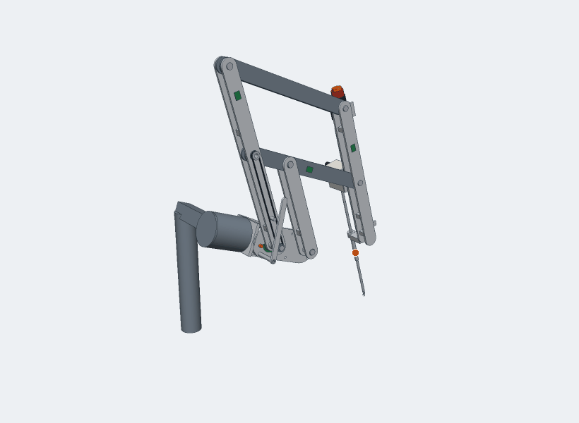
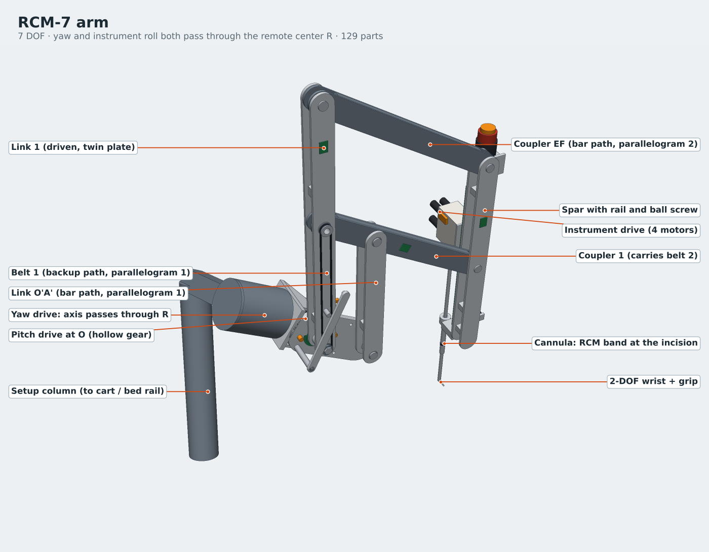
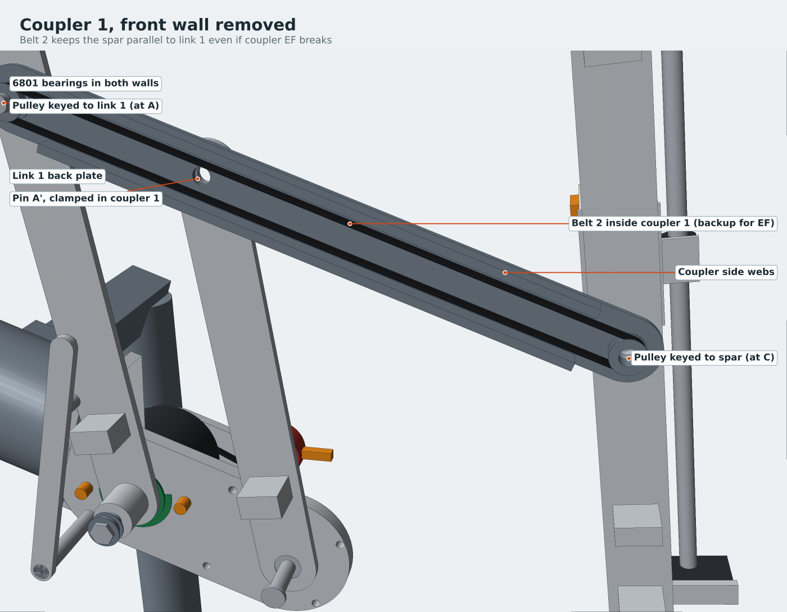

# RCM-7

A concept arm for minimally invasive surgery. The instrument always pivots about one point in space, the incision, and the arm holds that point with linkage geometry rather than software. It started as a planar linkage sketch and grew into a full 7-joint arm with a drive train, backup constraints, CAD for every part, and a simulator you can drive in the browser.

**[Open the simulator](https://borthalmue.github.io/rcm7-surgical-arm/)**



## How it works

The core is a double parallelogram. Link 1 is driven at pivot O, and two parallelograms copy its angle onto the spar that carries the instrument. With |OA| = |O′A′| = 300 mm and |AC| = |EF| = 420 mm, the spar's centerline always passes through the same point R, even though there is no hardware at R. That point is the remote center, and it sits at the incision.

Two more axes also pass through R. The yaw axis runs along the baseline from O through R, and the instrument rolls about its own shaft. Together they make R behave like a ball joint floating in space. Insertion slides the instrument along the shaft, and a cable-driven wrist adds pitch, yaw and grip at the tip. That's seven joints in total.



## Designing for failure

If an arm like this loses its remote center, the shaft levers against the body wall at the port. So the design gives each critical constraint a backup and keeps the backups independent of each other.

- **Two paths per parallelogram.** Each parallelogram holds its angle two ways: with a bar, and with a steel-cord timing belt carried by a different link. Either path alone keeps R fixed. My first layout had a belt riding on the same link it was supposed to back up. That would have failed together with the link, so the belt moved onto link 1.
- **Twin-plate links.** Every link is two plates, with a bearing in each plate, so one cracked plate doesn't drop the arm.
- **Brakes and encoder cross-checks.** Each powered joint has a spring-applied brake that holds when power is cut. It also has two encoders, one on the motor and one on the joint. If they disagree by more than 0.25°, the controller stops the arm.
- **Counterbalance.** A spring takes most of the gravity load off the pitch drive. The worst-case pitch torque drops from 15.0 N·m to 6.6 N·m across the full yaw range.
- **Wrist interlock.** The wrist stays locked until the jaws are clear of the cannula. When you retract, it straightens before the arm pulls back.



## Parts

The catalog parts are modelled from their published datasheet dimensions.

| Job | Part |
|---|---|
| Yaw gear unit | Harmonic Drive CSF-17-100-2UH |
| Yaw support bearing | THK RB5013 crossed roller |
| Pitch gear unit (hollow, so a shaft can pass through for belt 1) | Harmonic Drive SHG-17-100-2UH |
| Motors | maxon EC 45 flat, 50 W |
| Brakes | Kendrion Servo Slim Line, sizes 04 and 05 |
| Joint encoders | RLS AksIM-2 rings |
| Insertion | HIWIN MGN12 rail, TBI SFU1204 ball screw |
| Pivots | 6801 and 6803 ball bearings in double shear |
| Backup belts | Gates AT3 steel-cord PU |

The full list, with quantities and estimated masses, is in [`cad/BOM.csv`](cad/BOM.csv).

## What I checked

- **The remote center stays put.** R stays within 4.5 × 10⁻¹⁴ mm of the shaft line across 4,000 random poses of all seven joints. That's floating-point rounding. A second solver that works only from the link lengths agrees.
- **Nothing collides.** There are no collisions across 132 swept poses. The sweep caught real problems along the way: the parallel links touching near +50° of pitch, the yaw housing sitting in link 1's path, and the setup column getting hit at full yaw. The geometry here is the version with those fixed.
- **Every part is a closed solid.** All 129 part files are watertight.
- **The loads fit the parts.** The worst yaw gravity torque is 18.5 N·m, under the 24 N·m rating of the yaw gear unit.

The numbers are in [`cad/verification_report.json`](cad/verification_report.json).

## Using the simulator

Every joint is driven like a motor, with a top speed and an acceleration limit, so commands ramp in rather than jump. The internal parts move at their real ratios: the motor rotors, the ball screw, both backup belts and the counterbalance spring.

- **Joints tab:** sliders, typed values, and hold-to-jog buttons. Press 1–7 to pick a joint and the arrow keys to move it; hold Shift to go faster.
- **Tip tab:** hold a direction and the wrist moves in a straight line. Yaw, pitch and insertion are solved for you. There are also pose presets, including a safe retract.
- **Faults tab:** break a link or a belt, slip a drive belt, or cut power, and watch what the arm does.
- **Telemetry tab:** motor speeds, belt travel, spring force, gravity torques and the encoder comparison.

Add `?embed` to the URL to get just the 3D view and controls, which is handy for an iframe.

## What's in the repo

```
index.html              the simulator (served by GitHub Pages)
assets/rcm7-data.js     every part's mesh plus joint ratios, used by the simulator
cad/stl/                129 parts, each already in its assembly position
cad/RCM7_assembly.stl   the whole arm as one mesh
cad/BOM.csv             catalog and machined parts
cad/stl_to_step_freecad.py   converts the STLs to STEP with FreeCAD
generator/              the Python that builds all of the above
images/                 renders used in this README
```

## Opening the CAD

Every STL is in millimetres and already placed at the reference pose: yaw 0, pitch 0, insertion 100 mm. Import the whole `cad/stl/` folder into one assembly and the parts land where they belong.

- **Fusion 360:** use Insert Mesh, then Convert Mesh.
- **SolidWorks:** open the STLs with "Import as solid body".
- **STEP files:** run `freecadcmd cad/stl_to_step_freecad.py`. Round features stay faceted, because the source files are meshes.

## Rebuilding

```
pip install numpy scipy matplotlib
cd generator
python3 build.py        # geometry, checks, STL and BOM export (about 6 minutes)
python3 sim_payload.py  # simulator data
python3 make_site.py    # writes index.html, assets/ and cad/
```

All the dimensions live in `generator/model.py`. Change one, rerun those three commands, and the STLs, BOM, checks and simulator update together.

## Limits

This is a concept model, not a medical device. Fasteners, cable routing, sterile drapes and the cable capstans inside the instrument drive aren't modelled, and there's no stress analysis yet. The catalog parts are envelope models, so swap in each vendor's own CAD before making anything. The counterbalance is an ideal zero-free-length spring; a real build would approximate it with a spring and a cable over a pulley.
